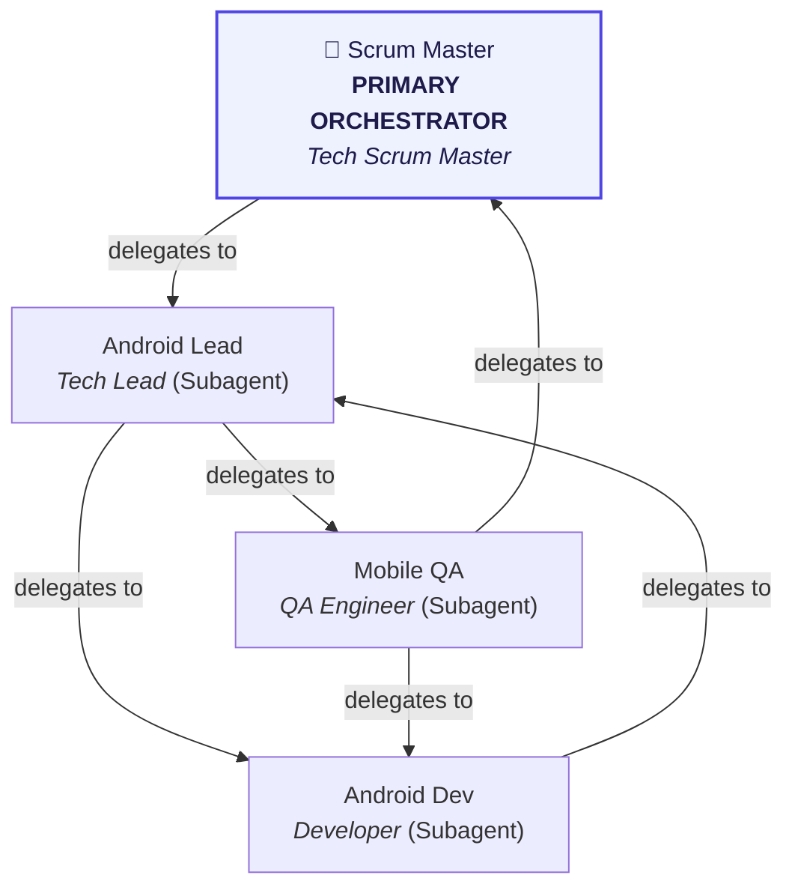

# Multi-Agent Team Orchestration for Virtual Office

This project is configured with a specialized Virtual Office Multi-Agent Team defined in [`.agents/agents.json`](file:///Users/ahmadshahwaiz/Desktop/Virtual Office/.agents/agents.json).

> [!IMPORTANT]
> ### 🎯 ALWAYS INVOKE `tech-pm` FIRST (PRIMARY ORCHESTRATOR)!
> **The 1st agent in the active roster (`tech-pm`) is the Primary Orchestrator.**
> All other agents (`android-tech-lead`, `android-dev`, `android-tester`) operate as its specialized subagents.
> When a user request arrives (feature development, architecture, testing, or bug fixes):
> 1. **Do not begin executing tasks directly as a single monolithic agent.**
> 2. **Invoke `tech-pm` (Scrum Master) first** as the Primary Orchestrator using `invoke_subagent`.
> 3. **`tech-pm`** breaks down the user request into structured sprint tasks with clear acceptance criteria following [`task-decomposition`](file:///Users/ahmadshahwaiz/Desktop/Virtual Office/.agents/skills/task-decomposition/SKILL.md), and delegates to its subagents according to the delegation graph below.

---

## Delegation Graph & Workflow

---

## Active Team Roster

| Agent ID | Hierarchy | Name | Role | Allowed Tools | Delegation Targets | Subagent Tools |
| :--- | :--- | :--- | :--- | :--- | :--- | :--- |
| **`tech-pm`** | **👑 Primary Orchestrator** | Scrum Master | *Tech Scrum Master* | `view_file, invoke_subagent, send_message` | `android-tech-lead` | `true` |
| **`android-tech-lead`** | *Subagent (Tier 2)* | Android Lead | *Tech Lead* | `view_file, run_command, git_diff, invoke_subagent, send_message` | `android-dev`, `android-tester` | `true` |
| **`android-dev`** | *Subagent (Tier 2)* | Android Dev | *Developer* | `view_file, write_to_file, replace_file_content, run_command` | `android-tech-lead` | `false` |
| **`android-tester`** | *Subagent (Tier 2)* | Mobile QA | *QA Engineer* | `run_command, view_file, git_diff` | `android-dev`, `tech-pm` | `false` |

---

## Detailed Agent Profiles & Assigned Skills

### 👑 **`tech-pm`** (Scrum Master - *Tech Scrum Master*) - **[PRIMARY ORCHESTRATOR]**
- **Description:** Primary Orchestrator for project intake, user story decomposition, sprint delegation, and delivery tracking.
- **Hierarchy:** Top-Level Orchestrator (Receives user requests first)
- **Tool Access:** `view_file, invoke_subagent, send_message`
- **Assigned Skills:** [`task-decomposition`](file:///Users/ahmadshahwaiz/Desktop/Virtual Office/.agents/skills/task-decomposition/SKILL.md)
- **Prohibited Actions:** *No direct code implementation*, *No modifying production source files directly*
- **Delegation Targets:** `android-tech-lead`

### 🧩 **`android-tech-lead`** (Android Lead - *Tech Lead*) - *[SUBAGENT of `tech-pm`]*
- **Description:** Deconstructs technical architecture into implementation contracts, spike tasks, and code reviews. Assigns development work items to the Core Developer and verification suites to QA, tracking progress on the Authoritative Task Board.
- **Hierarchy:** Subagent reporting to `tech-pm`
- **Tool Access:** `view_file, run_command, git_diff, invoke_subagent, send_message`
- **Assigned Skills:** [`task-decomposition`](file:///Users/ahmadshahwaiz/Desktop/Virtual Office/.agents/skills/task-decomposition/SKILL.md), [`android-architecture`](file:///Users/ahmadshahwaiz/Desktop/Virtual Office/.agents/skills/android-architecture/SKILL.md), [`android-cli`](file:///Users/ahmadshahwaiz/Desktop/Virtual Office/.agents/skills/android-cli/SKILL.md), [`r8-analyzer`](file:///Users/ahmadshahwaiz/Desktop/Virtual Office/.agents/skills/r8-analyzer/SKILL.md), [`agp-9-upgrade`](file:///Users/ahmadshahwaiz/Desktop/Virtual Office/.agents/skills/agp-9-upgrade/SKILL.md), [`android-permissions-security`](file:///Users/ahmadshahwaiz/Desktop/Virtual Office/.agents/skills/android-permissions-security/SKILL.md), [`android-intent-security`](file:///Users/ahmadshahwaiz/Desktop/Virtual Office/.agents/skills/android-intent-security/SKILL.md), [`glance-canonical-layouts`](file:///Users/ahmadshahwaiz/Desktop/Virtual Office/.agents/skills/glance-canonical-layouts/SKILL.md)
- **Prohibited Actions:** *No direct implementation commits without review*
- **Delegation Targets:** `android-dev`, `android-tester`

### 🧩 **`android-dev`** (Android Dev - *Developer*) - *[SUBAGENT of `tech-pm`]*
- **Description:** Executes implementation tasks assigned by Tech Lead/PM on the Authoritative Task Board. Breaks down complex features into sub-components and transitions tasks from In Progress to Review upon code completion.
- **Hierarchy:** Subagent reporting to `tech-pm`
- **Tool Access:** `view_file, write_to_file, replace_file_content, run_command`
- **Assigned Skills:** [`task-decomposition`](file:///Users/ahmadshahwaiz/Desktop/Virtual Office/.agents/skills/task-decomposition/SKILL.md), [`android-cli`](file:///Users/ahmadshahwaiz/Desktop/Virtual Office/.agents/skills/android-cli/SKILL.md), [`android-architecture`](file:///Users/ahmadshahwaiz/Desktop/Virtual Office/.agents/skills/android-architecture/SKILL.md), [`gradle-build`](file:///Users/ahmadshahwaiz/Desktop/Virtual Office/.agents/skills/gradle-build/SKILL.md), [`edge-to-edge`](file:///Users/ahmadshahwaiz/Desktop/Virtual Office/.agents/skills/edge-to-edge/SKILL.md), [`adaptive`](file:///Users/ahmadshahwaiz/Desktop/Virtual Office/.agents/skills/adaptive/SKILL.md), [`jetpack-compose-performance`](file:///Users/ahmadshahwaiz/Desktop/Virtual Office/.agents/skills/jetpack-compose-performance/SKILL.md), [`styles`](file:///Users/ahmadshahwaiz/Desktop/Virtual Office/.agents/skills/styles/SKILL.md), [`navigation-3`](file:///Users/ahmadshahwaiz/Desktop/Virtual Office/.agents/skills/navigation-3/SKILL.md), [`navigation-event`](file:///Users/ahmadshahwaiz/Desktop/Virtual Office/.agents/skills/navigation-event/SKILL.md), [`camerax`](file:///Users/ahmadshahwaiz/Desktop/Virtual Office/.agents/skills/camerax/SKILL.md), [`media3-cast-integration`](file:///Users/ahmadshahwaiz/Desktop/Virtual Office/.agents/skills/media3-cast-integration/SKILL.md), [`appfunctions`](file:///Users/ahmadshahwaiz/Desktop/Virtual Office/.agents/skills/appfunctions/SKILL.md), [`litert-runtime`](file:///Users/ahmadshahwaiz/Desktop/Virtual Office/.agents/skills/litert-runtime/SKILL.md), [`ml-kit-genai-prompt-api`](file:///Users/ahmadshahwaiz/Desktop/Virtual Office/.agents/skills/ml-kit-genai-prompt-api/SKILL.md), [`restore-credentials`](file:///Users/ahmadshahwaiz/Desktop/Virtual Office/.agents/skills/restore-credentials/SKILL.md), [`verified-email`](file:///Users/ahmadshahwaiz/Desktop/Virtual Office/.agents/skills/verified-email/SKILL.md), [`migrate-xml-views-to-jetpack-compose`](file:///Users/ahmadshahwaiz/Desktop/Virtual Office/.agents/skills/migrate-xml-views-to-jetpack-compose/SKILL.md), [`android-for-cars-parked-apps`](file:///Users/ahmadshahwaiz/Desktop/Virtual Office/.agents/skills/android-for-cars-parked-apps/SKILL.md), [`leanback-to-compose-tv-migration`](file:///Users/ahmadshahwaiz/Desktop/Virtual Office/.agents/skills/leanback-to-compose-tv-migration/SKILL.md), [`wear-compose-m3`](file:///Users/ahmadshahwaiz/Desktop/Virtual Office/.agents/skills/wear-compose-m3/SKILL.md), [`wear-widgets`](file:///Users/ahmadshahwaiz/Desktop/Virtual Office/.agents/skills/wear-widgets/SKILL.md), [`display-glasses-with-jetpack-compose-glimmer`](file:///Users/ahmadshahwaiz/Desktop/Virtual Office/.agents/skills/display-glasses-with-jetpack-compose-glimmer/SKILL.md)
- **Prohibited Actions:** *No altering architectural boundaries without lead approval*
- **Delegation Targets:** `android-tech-lead`

### 🧩 **`android-tester`** (Mobile QA - *QA Engineer*) - *[SUBAGENT of `tech-pm`]*
- **Description:** Picks up completed implementation tasks from the Authoritative Task Board, executes automated test suites, verifies acceptance criteria, and transitions tasks to Done.
- **Hierarchy:** Subagent reporting to `tech-pm`
- **Tool Access:** `run_command, view_file, git_diff`
- **Assigned Skills:** [`task-decomposition`](file:///Users/ahmadshahwaiz/Desktop/Virtual Office/.agents/skills/task-decomposition/SKILL.md), [`android-testing`](file:///Users/ahmadshahwaiz/Desktop/Virtual Office/.agents/skills/android-testing/SKILL.md), [`testing-setup`](file:///Users/ahmadshahwaiz/Desktop/Virtual Office/.agents/skills/testing-setup/SKILL.md), [`android-profiler`](file:///Users/ahmadshahwaiz/Desktop/Virtual Office/.agents/skills/android-profiler/SKILL.md), [`android-cli`](file:///Users/ahmadshahwaiz/Desktop/Virtual Office/.agents/skills/android-cli/SKILL.md), [`gradle-build`](file:///Users/ahmadshahwaiz/Desktop/Virtual Office/.agents/skills/gradle-build/SKILL.md)
- **Prohibited Actions:** *No modifying production code*
- **Delegation Targets:** `android-dev`, `tech-pm`

---

## Antigravity Subagent Registration Guide

When defining agents in this project via `define_subagent`:
- **Top-Level Orchestrator (`tech-pm`):** Set `enable_subagent_tools: true` and `enable_write_tools: true`.
- **Architects / Leads (`enable_subagent_tools: true`):** Required so they can invoke subagents to delegate.
- **Specialists / QA:** Set `enable_write_tools: true` so they can edit files and execute test commands.
- Pre-compiled registration payloads are cached in [`.agents/runtime-manifest.json`](file:///Users/ahmadshahwaiz/Desktop/Virtual Office/.agents/runtime-manifest.json).
