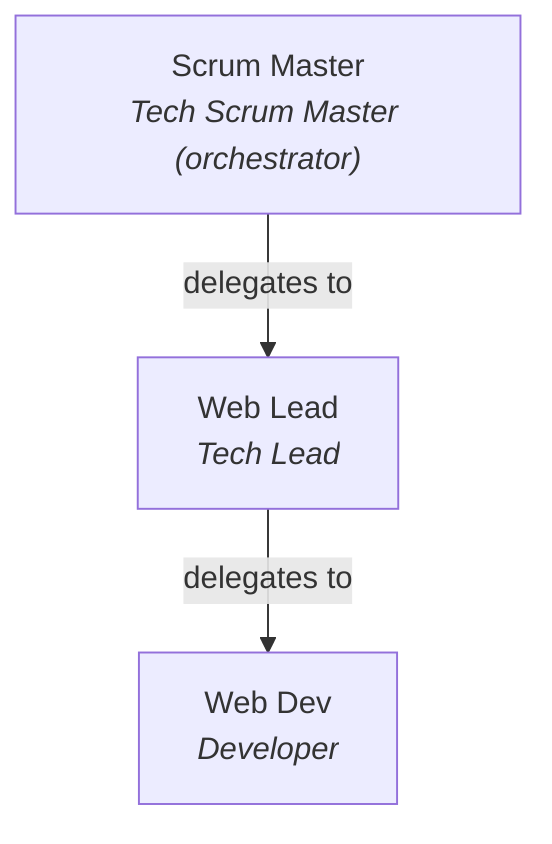

<!-- generated by node bin/agents.js sync: edit .agents/definitions/*.md instead -->
# Virtual Office: agent team

ALWAYS INVOKE `tech-pm` FIRST: send every software request to Scrum Master, the orchestrator. It registers the request and role cards on the Kanban board, then delegates each card by key. Don't implement a request directly as a single agent.

## Team
| Agent | Role | Hands work to | Reports to | Never |
| :--- | :--- | :--- | :--- | :--- |
| `tech-pm` | Tech Scrum Master (orchestrator) | `web-tech-lead` | user | No direct application code modifications |
| `web-tech-lead` | Tech Lead | `web-dev` | `tech-pm` | No direct unreviewed code pushes to main |
| `web-dev` | Developer | - | `web-tech-lead` | No breaking architectural contracts |

Role definitions: `.agents/definitions/<id>.md`. Compiled prompts: `.agents/runtime-manifest.json`. Board protocol: `.agents/skills/kanban-handoff/SKILL.md`.

## Skills
- `tech-pm`: [kanban-handoff](.agents/skills/kanban-handoff/SKILL.md), [task-decomposition](.agents/skills/task-decomposition/SKILL.md), [requirement-analysis](.agents/skills/requirement-analysis/SKILL.md), [sprint-planning](.agents/skills/sprint-planning/SKILL.md), [read-jira](.agents/skills/read-jira/SKILL.md), [read-confluence](.agents/skills/read-confluence/SKILL.md), [writing-guidelines](.agents/skills/writing-guidelines/SKILL.md)
- `web-tech-lead`: [kanban-handoff](.agents/skills/kanban-handoff/SKILL.md), [task-decomposition](.agents/skills/task-decomposition/SKILL.md), [react-best-practices](.agents/skills/react-best-practices/SKILL.md), [composition-patterns](.agents/skills/composition-patterns/SKILL.md), [web-design-guidelines](.agents/skills/web-design-guidelines/SKILL.md), [vercel-optimize](.agents/skills/vercel-optimize/SKILL.md), [modern-web-guidance](.agents/skills/modern-web-guidance/SKILL.md)
- `web-dev`: [kanban-handoff](.agents/skills/kanban-handoff/SKILL.md), [feature-implementation](.agents/skills/feature-implementation/SKILL.md), [react-best-practices](.agents/skills/react-best-practices/SKILL.md), [composition-patterns](.agents/skills/composition-patterns/SKILL.md), [react-view-transitions](.agents/skills/react-view-transitions/SKILL.md), [modern-web-guidance](.agents/skills/modern-web-guidance/SKILL.md), [deploy-to-vercel](.agents/skills/deploy-to-vercel/SKILL.md)

## Registering subagents (`define_subagent`)
Use each role's `registrationPayload` from `.agents/runtime-manifest.json`: `enable_subagent_tools` for roles that delegate, `enable_write_tools` for roles that edit files.
