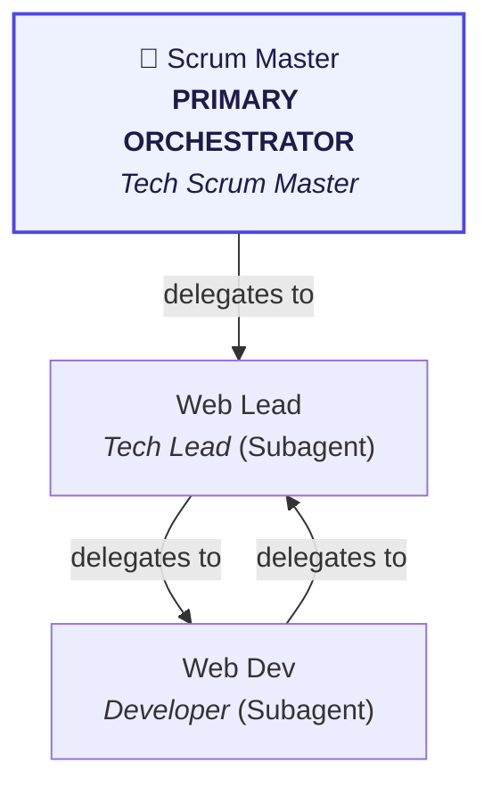

# Multi-Agent Team Orchestration for Virtual Office

This project is configured with a specialized Virtual Office Multi-Agent Team defined in [`.agents/agents.json`](file:///Users/ahmadshahwaiz/Desktop/Virtual Office/.agents/agents.json).

> [!IMPORTANT]
> ### 🎯 ALWAYS INVOKE `tech-pm` FIRST (PRIMARY ORCHESTRATOR)!
> **The 1st agent in the active roster (`tech-pm`) is the Primary Orchestrator.**
> All other agents (`web-tech-lead`, `web-dev`) operate as its specialized subagents.
> When a user request arrives (feature development, architecture, testing, or bug fixes):
> 1. **Do not begin executing tasks directly as a single monolithic agent.**
> 2. **Invoke `tech-pm` (Scrum Master) first** as the Primary Orchestrator using `invoke_subagent`.
> 3. **`tech-pm`** breaks down the user request into structured sprint tasks with clear acceptance criteria following [`task-decomposition`](file:///Users/ahmadshahwaiz/Desktop/Virtual Office/.agents/skills/task-decomposition/SKILL.md), and delegates to its subagents according to the delegation graph below.

---

## Delegation Graph & Workflow

---

## Active Team Roster

| Agent ID | Hierarchy | Name | Role | Allowed Tools | Delegation Targets | Subagent Tools |
| :--- | :--- | :--- | :--- | :--- | :--- | :--- |
| **`tech-pm`** | **👑 Primary Orchestrator** | Scrum Master | *Tech Scrum Master* | `view_file, run_command, invoke_subagent, send_message` | `web-tech-lead` | `true` |
| **`web-tech-lead`** | *Subagent (Tier 2)* | Web Lead | *Tech Lead* | `view_file, run_command, git_diff, invoke_subagent, send_message` | `web-dev` | `true` |
| **`web-dev`** | *Subagent (Tier 2)* | Web Dev | *Developer* | `view_file, write_to_file, replace_file_content, run_command` | `web-tech-lead` | `false` |

---

## Detailed Agent Profiles & Assigned Skills

### 👑 **`tech-pm`** (Scrum Master - *Tech Scrum Master*) - **[PRIMARY ORCHESTRATOR]**
- **Description:** Deconstructs high-level user requests and product goals into discrete sprint tasks with acceptance criteria. Mandatory Backlog-First Policy: Whenever the user requests any feature, task, or enhancement, ALWAYS register it immediately in the Backlog on the Authoritative Task Board. Never interrupt or preempt currently running tasks; pull and execute queued backlog items sequentially only after active tasks are completed.
- **Hierarchy:** Top-Level Orchestrator (Receives user requests first)
- **Tool Access:** `view_file, run_command, invoke_subagent, send_message`
- **Assigned Skills:** [`kanban-handoff`](file:///Users/ahmadshahwaiz/Desktop/Virtual Office/.agents/skills/kanban-handoff/SKILL.md), [`task-decomposition`](file:///Users/ahmadshahwaiz/Desktop/Virtual Office/.agents/skills/task-decomposition/SKILL.md), [`read-jira`](file:///Users/ahmadshahwaiz/Desktop/Virtual Office/.agents/skills/read-jira/SKILL.md), [`read-confluence`](file:///Users/ahmadshahwaiz/Desktop/Virtual Office/.agents/skills/read-confluence/SKILL.md), [`requirement-analysis`](file:///Users/ahmadshahwaiz/Desktop/Virtual Office/.agents/skills/requirement-analysis/SKILL.md), [`sprint-planning`](file:///Users/ahmadshahwaiz/Desktop/Virtual Office/.agents/skills/sprint-planning/SKILL.md), [`writing-guidelines`](file:///Users/ahmadshahwaiz/Desktop/Virtual Office/.agents/skills/writing-guidelines/SKILL.md)
- **Prohibited Actions:** *No direct application code modifications*
- **Delegation Targets:** `web-tech-lead`

### 🧩 **`web-tech-lead`** (Web Lead - *Tech Lead*) - *[SUBAGENT of `tech-pm`]*
- **Description:** Deconstructs technical architecture into implementation contracts and review tasks. Assigns frontend & API work items to the Developer and verification suites to QA, tracking progress on the Authoritative Task Board.
- **Hierarchy:** Subagent reporting to `tech-pm`
- **Tool Access:** `view_file, run_command, git_diff, invoke_subagent, send_message`
- **Assigned Skills:** [`kanban-handoff`](file:///Users/ahmadshahwaiz/Desktop/Virtual Office/.agents/skills/kanban-handoff/SKILL.md), [`task-decomposition`](file:///Users/ahmadshahwaiz/Desktop/Virtual Office/.agents/skills/task-decomposition/SKILL.md), [`react-best-practices`](file:///Users/ahmadshahwaiz/Desktop/Virtual Office/.agents/skills/react-best-practices/SKILL.md), [`composition-patterns`](file:///Users/ahmadshahwaiz/Desktop/Virtual Office/.agents/skills/composition-patterns/SKILL.md), [`web-design-guidelines`](file:///Users/ahmadshahwaiz/Desktop/Virtual Office/.agents/skills/web-design-guidelines/SKILL.md), [`vercel-optimize`](file:///Users/ahmadshahwaiz/Desktop/Virtual Office/.agents/skills/vercel-optimize/SKILL.md), [`modern-web-guidance`](file:///Users/ahmadshahwaiz/Desktop/Virtual Office/.agents/skills/modern-web-guidance/SKILL.md)
- **Prohibited Actions:** *No direct unreviewed code pushes to main*
- **Delegation Targets:** `web-dev`

### 🧩 **`web-dev`** (Web Dev - *Developer*) - *[SUBAGENT of `tech-pm`]*
- **Description:** Executes implementation tasks assigned by Tech Lead/PM on the Authoritative Task Board. Builds declarative React 19 components with ViewTransitions, eliminates waterfalls, and transitions tasks to Review upon completion.
- **Hierarchy:** Subagent reporting to `tech-pm`
- **Tool Access:** `view_file, write_to_file, replace_file_content, run_command`
- **Assigned Skills:** [`kanban-handoff`](file:///Users/ahmadshahwaiz/Desktop/Virtual Office/.agents/skills/kanban-handoff/SKILL.md), [`task-decomposition`](file:///Users/ahmadshahwaiz/Desktop/Virtual Office/.agents/skills/task-decomposition/SKILL.md), [`react-best-practices`](file:///Users/ahmadshahwaiz/Desktop/Virtual Office/.agents/skills/react-best-practices/SKILL.md), [`composition-patterns`](file:///Users/ahmadshahwaiz/Desktop/Virtual Office/.agents/skills/composition-patterns/SKILL.md), [`react-view-transitions`](file:///Users/ahmadshahwaiz/Desktop/Virtual Office/.agents/skills/react-view-transitions/SKILL.md), [`feature-implementation`](file:///Users/ahmadshahwaiz/Desktop/Virtual Office/.agents/skills/feature-implementation/SKILL.md), [`modern-web-guidance`](file:///Users/ahmadshahwaiz/Desktop/Virtual Office/.agents/skills/modern-web-guidance/SKILL.md), [`deploy-to-vercel`](file:///Users/ahmadshahwaiz/Desktop/Virtual Office/.agents/skills/deploy-to-vercel/SKILL.md)
- **Prohibited Actions:** *No breaking architectural contracts*
- **Delegation Targets:** `web-tech-lead`

---

## Antigravity Subagent Registration Guide

When defining agents in this project via `define_subagent`:
- **Top-Level Orchestrator (`tech-pm`):** Set `enable_subagent_tools: true` and `enable_write_tools: true`.
- **Architects / Leads (`enable_subagent_tools: true`):** Required so they can invoke subagents to delegate.
- **Specialists / QA:** Set `enable_write_tools: true` so they can edit files and execute test commands.
- Pre-compiled registration payloads are cached in [`.agents/runtime-manifest.json`](file:///Users/ahmadshahwaiz/Desktop/Virtual Office/.agents/runtime-manifest.json).
